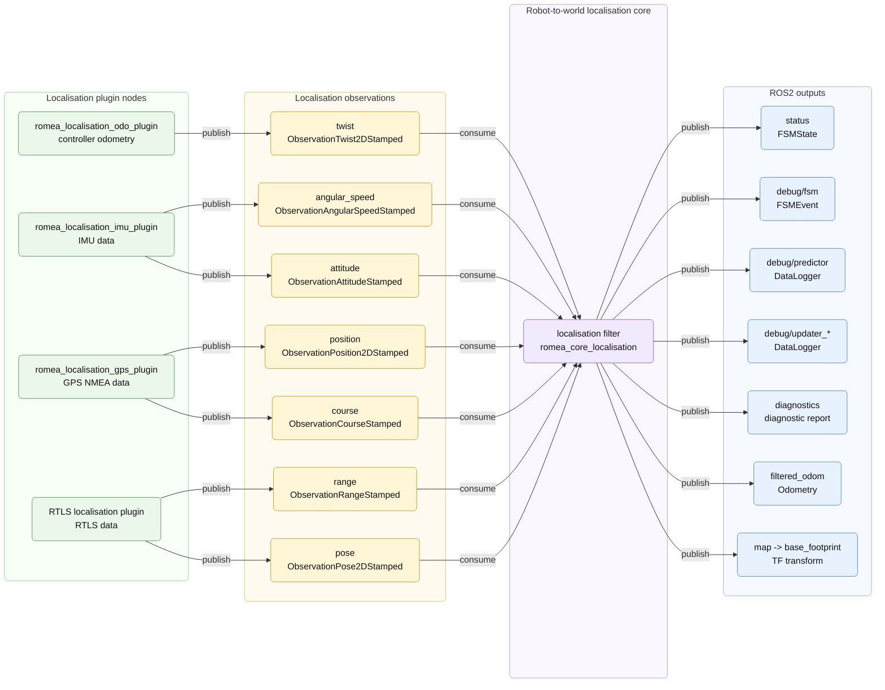

# romea_robot_to_world_localisation_core

`romea_robot_to_world_localisation_core` provides ROS2 component nodes that fuse localisation observations into a robot-to-world localisation estimate.

The package does not read sensors directly. It consumes typed observation messages from `romea_localisation_msgs`, typically produced by localisation plugin nodes, and feeds them to a robot-to-world localisation filter from `romea_core_localisation`.

It also provides an optional robot-to-world and robot-to-robot mode. In that mode, the node keeps the robot-to-world localisation filter and also receives the filtered odometry of a leader robot in order to publish the relative leader pose in the follower robot frame.

## 1) Concept

Localisation plugin nodes convert ROS2 sensor or controller data into typed observations. This package is the filter layer that subscribes to these observations and instantiates robot-to-world filter implementations provided by `romea_core_localisation`.

The filter fuses odometry, IMU, GPS and optional RTLS observations to estimate the vehicle pose in the world frame, together with its uncertainty. The result is published as `nav_msgs/msg/Odometry` and as a TF transform between the world frame and the robot base frame. The node also publishes diagnostics to check that the expected observations exist and arrive at the expected rate, a finite-state-machine status, and FSM transition events.

A second node variant also computes the relative pose between this robot and a leader robot. It consumes the leader robot localisation result as `nav_msgs/msg/Odometry` and publishes the leader pose in the follower robot frame. This is useful for platooning or cooperative behaviours.



## 2) Provided nodes

The documented nodes use the Kalman filter implementation.

| Executable | Purpose |
| ---------- | ------- |
| `robot_to_world_kalman_localisation_node` | Estimate the robot pose in the world frame from localisation observations. |
| `robot_to_world_and_robot_to_robot_kalman_localisation_node` | Estimate robot-to-world localisation and compute the relative pose of a leader robot from its filtered odometry. |

All nodes use the ROS2 node name `robot_to_world_localisation`.

## 3) Input topics

The observation topics are local to the node namespace. They are usually remapped according to the robot configuration.

| Topic | Message | Used by |
| ----- | ------- | ------- |
| `twist` | `romea_localisation_msgs/msg/ObservationTwist2DStamped` | Twist, linear speed or left/right linear speed updater, depending on enabled updater parameters. |
| `angular_speed` | `romea_localisation_msgs/msg/ObservationAngularSpeedStamped` | Angular speed updater. |
| `attitude` | `romea_localisation_msgs/msg/ObservationAttitudeStamped` | Attitude updater. |
| `position` | `romea_localisation_msgs/msg/ObservationPosition2DStamped` | Position updater. |
| `course` | `romea_localisation_msgs/msg/ObservationCourseStamped` | Course updater. |
| `range` | `romea_localisation_msgs/msg/ObservationRangeStamped` | Range updater. |
| `pose` | `romea_localisation_msgs/msg/ObservationPose2DStamped` | Pose updater. |
|                 |                                                              |                                                              |

An updater is created only when its `minimal_rate` parameter is greater than zero. A `minimal_rate` equal to `0` is only a node configuration convention used to disable the updater; constructed core updaters require a strictly positive rate.

## 4) Output topics

| Topic | Message | Description |
| ----- | ------- | ----------- |
| `filtered_odom` | `nav_msgs/msg/Odometry` | Estimated robot pose and twist in the world frame, with uncertainty. |
| `status` | `romea_common_msgs/msg/FSMState` | Current localisation finite-state-machine status. |
| `debug/fsm` | `romea_common_msgs/msg/FSMEvent` | Localisation finite-state-machine transitions. |
| `debug/predictor` | `romea_common_msgs/msg/DataLogger` | Debug data for the predictor. |
| `debug/<updater_name>` | `romea_common_msgs/msg/DataLogger` | Debug data for the named updater. |
| `/diagnostics` | `diagnostic_msgs/msg/DiagnosticArray` | Diagnostic information for configured updaters. |
| `filtered_leader_pose` | `romea_common_msgs/msg/PoseAndTwist2DStamped` | Relative leader pose and twist, only for robot-to-world and robot-to-robot nodes. |

`debug/*` topics publish only when the `debug` parameter is `true`.

The node also publishes the TF transform from `map_frame_id` to `base_footprint_frame_id`. The `filtered_leader_pose` frame is the configured `base_footprint_frame_id`.

## 5) Parameters

### 5.1) Common parameters

| Parameter | Type | Default | Description |
| --------- | ---- | ------- | ----------- |
| `base_footprint_frame_id` | string | `base_footprint` | Robot base frame used by the localisation outputs. |
| `map_frame_id` | string | `map` | World frame used by the robot-to-world estimate. |
| `publish_rate` | int | required | Timer frequency used to publish status, diagnostics and localisation results. |
| `debug` | bool | `false` | Enables debug log files. |
| `log_directory` | string | ROS2 logging directory | Directory used when debug logging is enabled. |

### 5.2) Filter and predictor parameters

| Parameter | Type | Description |
| --------- | ---- | ----------- |
| `filter.state_pool_size` | int | Size of the internal filter state pool. |
| `predictor.maximal_dead_recknoning_travelled_distance` | double | Maximum travelled distance allowed in dead-reckoning mode. |
| `predictor.maximal_dead_recknoning_elapsed_time` | double | Maximum elapsed time allowed in dead-reckoning mode. |

### 5.3) Updater parameters

Proprioceptive updaters use observations that describe the robot motion between two instants. A `minimal_rate` equal to `0` disables the updater before it is constructed.

| Updater | Topic | Default `minimal_rate` | Description |
| ------- | ----- | ---------------------- | ----------- |
| `twist_updater` | `twist` | `10` | Uses the full 2D twist observation. |
| `linear_speed_updater` | `twist` | `0` | Uses a single linear speed observation. |
| `linear_speeds_updater` | `twist` | `0` | Uses left/right linear speed observations. |
| `angular_speed_updater` | `angular_speed` | `0` | Uses angular speed observations. |
| `attitude_updater` | `attitude` | `10` | Uses attitude observations. |

Exteroceptive updaters use observations that directly constrain the robot pose in the world frame, or through landmarks/ranges. They also declare `<updater>.mahalanobis_distance_rejection_threshold`, used to reject outliers whose innovation is too far from the current filter state.

| Updater | Topic | Default `minimal_rate` | Default `trigger` | Default Mahalanobis threshold | Description |
| ------- | ----- | ---------------------- | ----------------- | ----------------------------- | ----------- |
| `position_updater` | `position` | `1` | `always` | `5.0` | Uses 2D position observations. |
| `course_updater` | `course` | `1` | `once` | `5.0` | Uses course observations. |
| `range_updater` | `range` | `0` | `always` | `5.0` | Uses range observations. |
| `pose_updater` | `pose` | `0` | `always` | `5.0` | Uses 2D pose observations. |

`trigger` can be `always` or `once`. With `always`, each received observation can update the filter. With `once`, the updater is used only for the first valid observation, which is useful for initialisation data such as course.

## 6) Configuration and run

Run a robot-to-world Kalman localisation node with:

```bash
ros2 run romea_robot_to_world_localisation_core robot_to_world_kalman_localisation_node \
  --ros-args --params-file path/to/robot_to_world_localisation.yaml
```

Run the robot-to-world and robot-to-robot variant with:

```bash
ros2 run romea_robot_to_world_localisation_core robot_to_world_and_robot_to_robot_kalman_localisation_node \
  --ros-args --params-file path/to/robot_to_world_localisation.yaml
```

Example configuration:

```yaml
robot_to_world_localisation:
  ros__parameters:
    filter:
      state_pool_size: 1000

    predictor:
      maximal_dead_recknoning_travelled_distance: 2.0
      maximal_dead_recknoning_elapsed_time: 10.0

    map_frame_id: map
    base_footprint_frame_id: base_footprint
    publish_rate: 10
    debug: false

    twist_updater:
      minimal_rate: 10

    angular_speed_updater:
      minimal_rate: 10

    attitude_updater:
      minimal_rate: 10

    position_updater:
      minimal_rate: 1
      trigger: always
      mahalanobis_distance_rejection_threshold: 5.0

    course_updater:
      minimal_rate: 1
      trigger: once
      mahalanobis_distance_rejection_threshold: 5.0

    range_updater:
      minimal_rate: 0
      trigger: always
      mahalanobis_distance_rejection_threshold: 5.0

    pose_updater:
      minimal_rate: 0
      trigger: always
      mahalanobis_distance_rejection_threshold: 5.0
```

## 7) Notes

The package installs example configuration files in `config/`:

* `core.yaml`: enables the full set of common updaters;
* `gps_only.yaml`: enables odometry, IMU, position and course observations;
* `gps+rtls.yaml`: enables the same GPS-based observations plus pose and range observations.

The example files are flat parameter fragments. When used directly with `ros2 run --params-file`, wrap their content under the `robot_to_world_localisation.ros__parameters` key as shown above.

## License

This project is released under the Apache License 2.0. See the `LICENSE` file for details.

## Authors

This package was developed by **Jean Laneurit** in the context of the BaudetRob2 ANR project.
